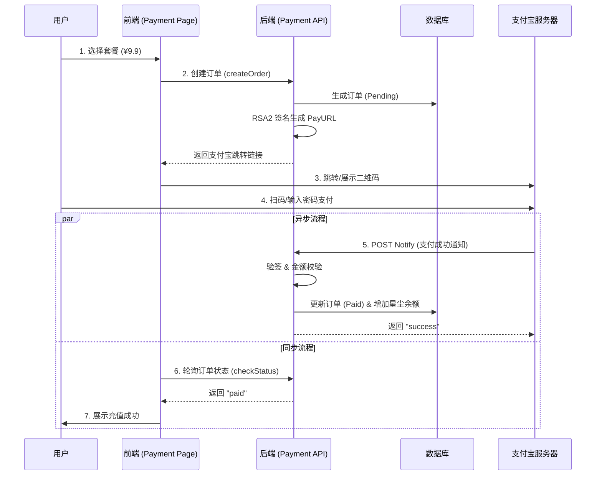

# 🌌 瑶光工坊 · 星尘支付系统 (Stardust Payment System)

## 1. 概述

星尘支付系统是瑶光工坊（Low_code）平台的原生充值模块，用于管理平台通用资源货币——**星尘 (Stardust)** 的流通。
该系统采用商业级支付架构，支持 **支付宝 (Alipay)** 真实交易（含沙箱环境），通过严格的签名机制与异步回调确保资金安全。

### 核心能力
- **商品化套餐**：支持灵活配置不同额度的星尘充值包（如星火包、星河包）。
- **收银台模式**：统一的支付引导界面，支持扫码支付与网页跳转支付。
- **资金安全**：基于 RSA2 签名的异步通知机制，杜绝前端篡改。
- **实时反馈**：前端轮询 + 后端回调的双重保障，确保用户支付后秒级到账。

---

## 2. 核心架构与流程

本模块采用 **“收银台 + 异步回调”** 经典支付模式。

### 2.1 交互流程图 (Sequence Diagram)



---

## 3. 目录结构规范

所有支付相关代码均收敛于 `src/pages/Payment`，保持高内聚。

```text
src/pages/Payment/
├── README.md               # 本文档
├── index.tsx               # 支付收银台主页 (路由: /payment)
├── index.module.scss       # 样式文件
├── types.ts                # 类型定义 (Package, Order, PaymentMethod)
├── constants.ts            # 常量定义 (轮询间隔, 状态枚举)
├── components/             # 支付专用组件
│   ├── PackageCard.tsx     # 套餐卡片组件
│   ├── PaymentModal.tsx    # 支付确认/二维码弹窗
│   └── ResultState.tsx     # 支付结果反馈组件
└── services/               # 支付相关 API
    └── payment.ts          # 封装 createOrder, checkStatus, getPackages
```

---

## 4. 数据协议与接口规范

### 4.1 核心数据模型

#### 充值套餐 (StardustPackage)
前端展示用，由后端动态下发。
```typescript
interface StardustPackage {
  id: string;        // 套餐ID, e.g., "pkg_basic_001"
  name: string;      // 名称, e.g., "星火包"
  price: number;     // 价格(CNY), e.g., 9.90
  stardust: number;  // 包含星尘数, e.g., 10000
  tag?: string;      // 营销标签, e.g., "新人推荐"
  description?: string; // 描述文案
}
```

#### 订单状态 (OrderState)
用于轮询检查。
```typescript
interface OrderState {
  orderId: string;
  status: 'pending' | 'paid' | 'cancelled' | 'failed';
  amount: number;
  currency: 'CNY';
  paidAt?: string;   // ISO8601 时间
}
```

### 4.2 后端接口定义 (API Contract)

#### A. 获取套餐列表
- **Endpoint**: `GET /api/payment/packages`
- **Response**: `StardustPackage[]`

#### B. 创建支付订单
- **Endpoint**: `POST /api/payment/alipay/pay`
- **Request**:
  ```json
  {
    "packageId": "pkg_basic_001",
    "method": "alipay_pc" // 或 "alipay_qr"
  }
  ```
- **Response**:
  ```json
  {
    "orderId": "ORD_20260120_XXXX",
    "payUrl": "https://openapi.alipay.com/gateway.do?..." // 签名后的跳转链接
  }
  ```

#### C. 查询订单状态 (轮询)
- **Endpoint**: `GET /api/payment/orders/:orderId/status`
- **Response**: `OrderState`

---

## 5. 开发与调试指南

### 5.1 前置条件
开发真实支付功能需要以下环境支持：
1.  **支付宝沙箱账号**：[支付宝开放平台-沙箱](https://open.aliyun.com/platform/sandbox)
    - 包含：APPID, 支付宝公钥, 应用私钥。
2.  **内网穿透工具**：支付宝服务器需要回调本地开发环境。
    - 推荐工具：`ngrok`, `cpolar`, `localtunnel`。
    - 示例命令：`ngrok http 8080` -> 获取公网 URL `https://xxxx.ngrok.io`。

### 5.2 调试步骤
1.  **启动后端**：配置 `ALIPAY_APP_ID`, `ALIPAY_PRIVATE_KEY` 等环境变量。
2.  **配置回调**：将后端配置中的 `NOTIFY_URL` 设置为穿透后的公网地址 (e.g., `https://xxxx.ngrok.io/api/payment/alipay/notify`)。
3.  **前端发起**：在 `/payment` 页面点击充值，获取 `payUrl`。
4.  **沙箱支付**：使用沙箱版支付宝 App 扫码，或输入沙箱买家账号密码支付。
5.  **观察日志**：确认后端收到 `POST /notify` 请求并验签通过。

---

## 6. 安全与风控 (Security)

### 6.1 签名机制
所有支付请求均通过 **RSA2 (SHA256WithRSA)** 签名。
- **请求签名**：后端使用应用私钥对参数签名，支付宝使用应用公钥验签。
- **响应验签**：后端收到回调后，必须使用支付宝公钥验签，确保通知来自支付宝官方。

### 6.2 幂等性与金额校验
后端回调处理必须遵循：
1.  **幂等性**：同一笔订单号 (`out_trade_no`) 可能收到多次通知，需检查 DB 状态，若已 `paid` 则直接返回 `success`。
2.  **金额校验**：必须核对回调中的 `total_amount` 与数据库中订单金额是否完全一致，防止恶意修改金额（如 0.01 元购买高级套餐）。

---

## 7. 国际化 (i18n)

相关文案需收录于 `src/i18n/locales/`，命名空间建议为 `payment.*`。

```json
// zh-CN.json
{
  "payment": {
    "title": "充值星尘",
    "balance": "当前余额",
    "packages": {
      "spark": "星火包",
      "galaxy": "星河包"
    },
    "status": {
      "success": "充值成功",
      "pending": "等待支付..."
    },
    "action": {
      "pay": "支付宝支付",
      "retry": "重新支付"
    }
  }
}
```

---

## 8. 常见问题 (FAQ)

**Q: 为什么支付成功了，前端还是显示“等待支付”？**
A: 请检查后端是否成功接收到了支付宝的 `notify` 回调。如果内网穿透失效，后端无法更新订单状态，前端轮询自然也查不到。

**Q: 必须使用真实资金测试吗？**
A: 不需要。请严格使用 **支付宝沙箱环境**，它提供了虚拟余额和虚拟账号，流程与真实环境完全一致。

**Q: 扫码支付和跳转支付有什么区别？**
A: 
- **跳转支付 (ComputerWebPay)**：适合 PC 浏览器，会跳离当前站。
- **扫码支付 (Precreate)**：后端生成二维码内容，前端展示二维码，用户体验更好（不跳出）。本方案目前优先实现跳转模式。
